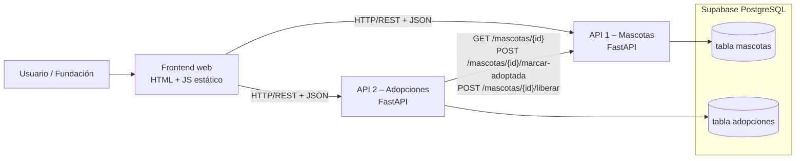

# Huellas de Esperanza – Plataforma de adopción responsable (SOA)

Examen 2 – Arquitectura Orientada a Servicios · Entrega: 9 de noviembre de 2026

## 1. Problema y solución
La Fundación tenía la información de mascotas y solicitudes dispersa. La plataforma centraliza: **catálogo de mascotas** (API 1) y **gestión de solicitudes** (API 2), con un frontend web que consume ambos servicios.

## 2. Arquitectura



| Servicio | Responsabilidad | Datos propios |
|---|---|---|
| API 1 – Mascotas | CRUD de mascotas, consulta y **dueña del estado** (`disponible` / `adoptada`) | `mascotas` |
| API 2 – Adopciones | Registrar, consultar, aprobar y rechazar solicitudes; orquesta el proceso | `adopciones` |
| Frontend | Catálogo, formulario de solicitud, panel de aprobación | — |

Regla SOA clave: **cada API solo escribe en sus propias tablas**; API 2 nunca toca `mascotas`, siempre pasa por la API 1. No hay llave foránea entre tablas (acoplamiento solo por contrato HTTP).

## 3. Comunicación entre APIs (proceso de adopción)
1. `POST /adopciones` → API 2 hace `GET /mascotas/{id}` a API 1; si no existe → 404, si no está disponible → 409.
2. `POST /adopciones/{id}/aprobar` → API 2 llama `POST /mascotas/{id}/marcar-adoptada` (UPDATE atómico `WHERE estado='disponible'`; 409 si ya fue adoptada).
3. API 2 guarda la solicitud como `aprobada`. Si falla, **compensa** llamando `POST /mascotas/{id}/liberar`.
4. Las demás solicitudes pendientes de esa mascota se rechazan automáticamente.

**Evitar dos adopciones aprobadas (defensa en 2 capas):** (a) transición atómica en API 1; (b) índice único parcial en BD `uq_una_aprobada_por_mascota`.

## 4. Modelo de datos (`sql/schema.sql`)
**mascotas**: id (uuid PK), nombre, especie (perro/gato/otro), raza, edad_meses, descripcion, foto_url, estado, creado_en
**adopciones**: id (uuid PK), mascota_id (referencia lógica), mascota_nombre, solicitante_nombre/email/telefono, motivo, estado (pendiente/aprobada/rechazada), creado_en, resuelto_en

## 5. Decisiones técnicas
- FastAPI → Swagger/OpenAPI automático en `/docs`.
- Supabase (PostgreSQL) con una sola instancia y tablas separadas por servicio (simplicidad; migrable a una BD por servicio).
- Compensación en lugar de transacción distribuida (patrón saga simplificado).
- `/health` en ambas APIs; el de Adopciones verifica también a Mascotas.
- Frontend estático sin build: despliegue trivial y URLs configurables por `?m=...&a=...`.

## 6. Ejecución local
```bash
# 1. Supabase: ejecutar sql/schema.sql en el SQL Editor
# 2. API 1
cd mascotas_api && cp .env.example .env   # completar credenciales
pip install -r requirements.txt && uvicorn main:app --port 8001
# 3. API 2 (otra terminal)
cd adopciones_api && cp .env.example .env
pip install -r requirements.txt && uvicorn main:app --port 8002
# 4. Frontend
cd frontend && python -m http.server 5500   # abrir http://localhost:5500
```
Swagger: http://localhost:8001/docs y http://localhost:8002/docs

## 7. Pruebas de integración
```bash
pip install pytest httpx
MASCOTAS_URL=https://TU-API1 ADOPCIONES_URL=https://TU-API2 pytest -v tests/
```
Cubren: salud integrada, mascota inexistente (404), flujo completo con cambio de estado en API 1, imposibilidad de doble aprobación (409) y rechazo sin afectar disponibilidad.
**Evidencia:** guardar captura de la salida de `pytest -v` y de Swagger (`/docs`) en la carpeta `docs/`.

## 8. Despliegue en la nube (Render + GitHub)
1. Subir este repositorio a GitHub.
2. En Render → *New → Blueprint* → seleccionar el repo (usa `render.yaml`).
3. Definir variables: `SUPABASE_URL`, `SUPABASE_KEY` en ambas APIs y `MASCOTAS_API_URL` (URL pública de API 1) en API 2.
4. Frontend: editar las dos constantes `API_MASCOTAS` / `API_ADOPCIONES` en `frontend/index.html` con las URLs públicas (o usar el servicio estático del blueprint).
5. Nota: el plan gratuito de Render duerme los servicios; abrir `/health` antes de la demo.

## 9. Guion de socialización (7 min)
| Min | Contenido |
|---|---|
| 0:00–1:00 | Problema de la Fundación y solución |
| 1:00–2:30 | Diagrama de arquitectura y responsabilidades |
| 2:30–3:30 | Modelo de datos y regla de una sola adopción aprobada |
| 3:30–6:00 | **Demo en vivo:** registrar mascota → 2 solicitudes → aprobar una → la otra queda rechazada → mascota "Adoptada" |
| 6:00–7:00 | Decisiones técnicas (saga/compensación, índice único) y mejoras futuras (autenticación, notificaciones) |
